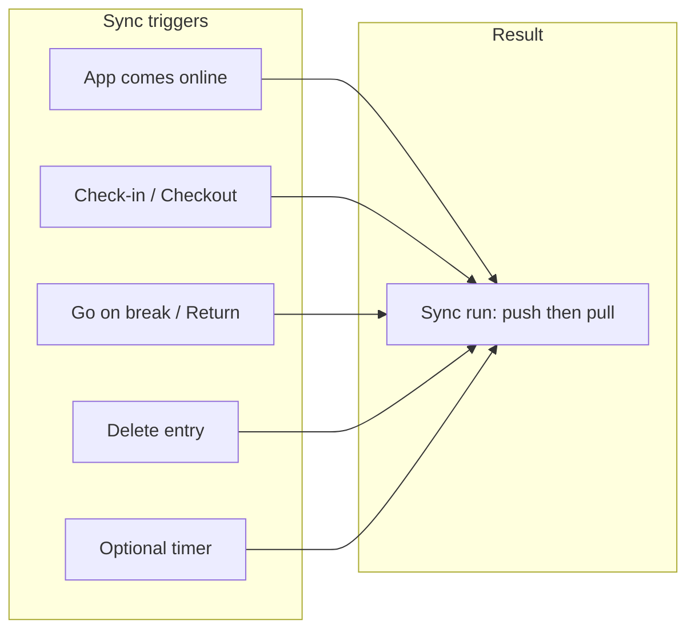
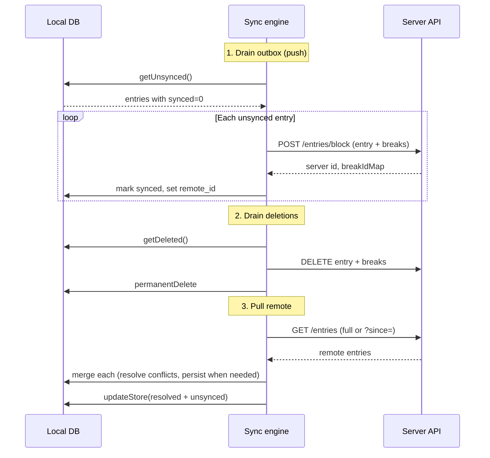
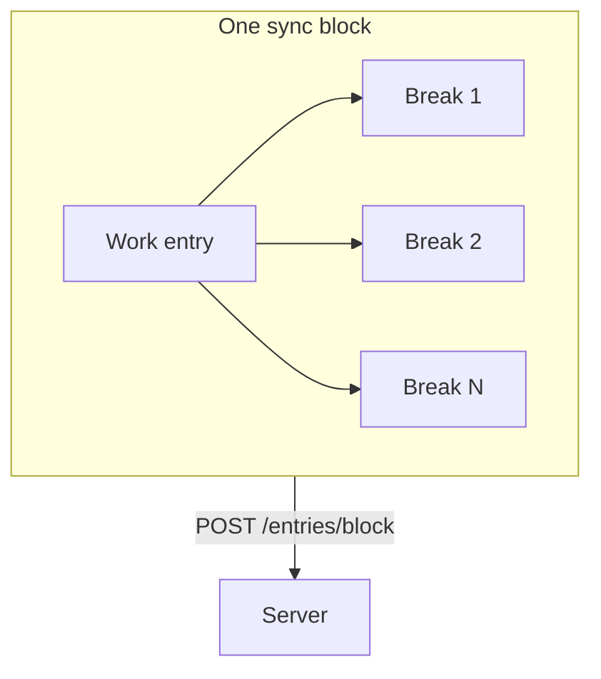

# How Remote and Local Entries Stay in Sync

This document describes how the application keeps work entries (and their breaks) in sync between the device and the server. It is intended for stakeholders and clients who need a clear overview of the sync behaviour, data flow, and reliability guarantees.

---

## Summary

We use an **offline-first, outbox-style sync**:

- The device always keeps a local copy of work entries and breaks.
- When online, we **push** local changes to the server first, then **pull** server data and **merge** it with local data.
- Conflicts (e.g. same entry changed in both places) are resolved with a configurable strategy (e.g. last-write-wins).
- Work entries and their breaks are synced together as a single **block**, so they never get out of step.
- Sync runs automatically when the app comes online, after user actions (check-in, break, checkout), and optionally on a timer.

**One sentence:** We keep remote and local in sync by always pushing local changes first (entry + breaks as a block), then pulling from the server and merging with conflict resolution, and by triggering sync when the app goes online and after every relevant user action.

---

## 1. Data Model and Identity

| Location | Description |
|----------|-------------|
| **Local** | Each work entry and break is stored in the device database (SQLite). Entries have a local `id` and, after a successful push, a `remote_id` (the server’s id). |
| **Remote** | The API stores entries and breaks and assigns server ids. The block endpoint accepts our local id for mapping and returns the server id. |
| **Link** | We treat local and remote as the “same” entry when they match by `remote_id` (with fallback to `id` for backward compatibility). This id mapping keeps remote and local aligned. |

---

## 2. When Sync Runs

Sync is triggered in these situations:

- **App start / coming online** – When the app detects that the device is online, it runs a full sync.
- **User actions** – After check-in, go-on-break, return-from-break, checkout, or delete, we request a sync (debounced so rapid actions result in one sync run).
- **Optional periodic sync** – If configured, sync can also run on a timer while the app is online.

So remote and local are reconciled whenever the app is online and something has changed, or when the app has just started.

### Sync trigger flow

---

## 3. What Happens in One Sync Run

Each sync run performs **three steps in a fixed order**. This order is important for consistency.

### High-level sequence

### Step 1 – Drain outbox (push)

- We read all work entries with `synced = 0` from the local DB.
- For each such entry, we send the **block** (that entry plus all its breaks) to the API with `POST /entries/block`.
- The API returns the server id and a mapping for break ids.
- We mark the entry and its breaks as synced and store `remote_id` (and break remote ids) in the local DB.

**Result:** Everything we just pushed is now aligned between local and remote.

### Step 2 – Drain deletions

- We read soft-deleted entries from the local DB.
- We call the API to delete those entries (and their breaks).
- After a successful API delete, we permanently remove those entries from the local DB.

**Result:** Deleted entries are removed on both server and device.

### Step 3 – Pull remote

- We fetch entries from the API (full list or incremental with `?since=`).
- For each remote entry we **merge** with local: we match by `remote_id` (or `id`).
  - If there is no local row, we persist the remote entry as synced.
  - If local has unsynced changes, we keep the local version (it will be pushed in a later run).
  - Otherwise we run **conflict resolution** (e.g. last-write-wins on `updatedAt`), persist the resolved row when needed, and refresh the UI store from the combined set (resolved remotes + unsynced locals).

**Result:** The UI shows a single, merged view of remote and local data.

---

## 4. Block Sync (Entries + Breaks Together)

Work entries and breaks are **not** synced as independent resources. They are synced as a **block**: one entry plus all its breaks in one request.

- **Push:** One `POST /entries/block` sends the entry and all its breaks (and any break ids to delete). The server replaces that entry’s breaks with what we send. So after a successful push, server state for that entry and its breaks matches what we had locally.
- **Pull:** We fetch entries and breaks; the merge logic can sync break state from remote to local when appropriate (e.g. when the local entry is already synced and has no unsynced breaks).

So remote and local stay in sync **per block**: we avoid situations where the server has an entry without its breaks or breaks without their entry.

---

## 5. Conflict Resolution

When the same entry exists both locally and remotely and both sides are considered “synced”, we merge using a configurable strategy. The default is **last-write-wins** based on `updatedAt`:

- The version with the newer `updatedAt` wins.
- The resolved version is written to the local DB and used for the UI.
- Any subsequent local change will be pushed in a later sync run.

This keeps local and remote from drifting apart when both sides have been updated.

---

## 6. Offline and Failure Handling

| Situation | Behaviour |
|-----------|-----------|
| **Offline** | No push or pull. All changes stay local (`synced = 0`). When the device is back online, the next sync run pushes them and then pulls, so remote and local converge again. |
| **Push fails** | The entry stays `synced = 0`. We retry on the next sync. `remote_id` is only set after a successful push. |
| **Pull fails or empty** | We fall back to showing data from the local DB only. The user sees a consistent (local) state until the next successful pull. |

---

## Related documentation

- [Sync flow (technical)](./SYNC_FLOW.md) – Components and triggers in code.
- [Architecture overview](./ARCHITECTURE_OVERVIEW.md) – High-level architecture and sync strategy.
- [ID strategy](./ID_STRATEGY.md) – How local and remote ids are assigned and used.
